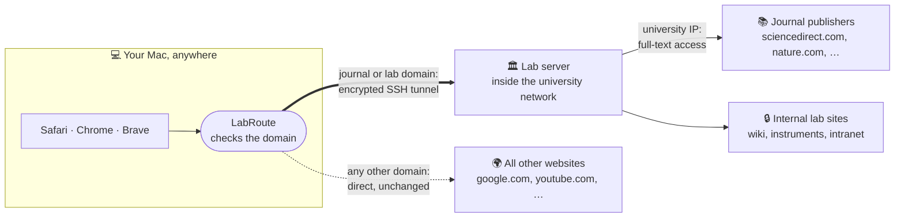
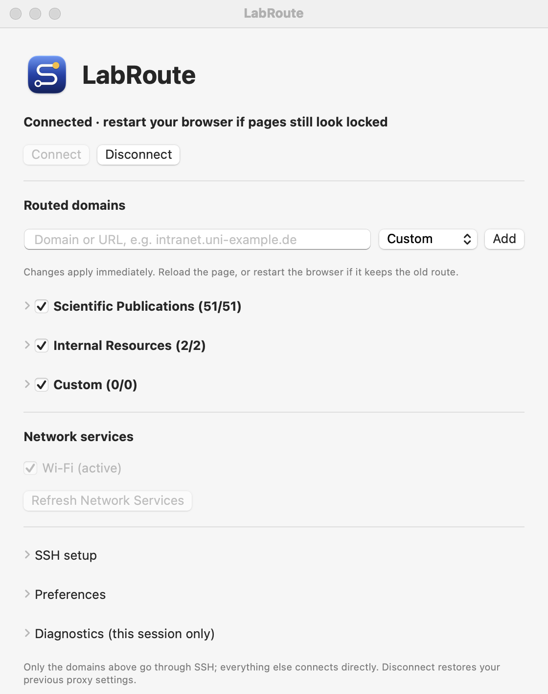

<p align="center"></p>

# LabRoute

A small native macOS menu-bar app that sends **selected websites** through an SSH connection to your lab or university server. You can reach internal lab pages and use your institution's journal subscriptions from anywhere, without installing a full VPN client.

## What it does

You're at home, at a conference or in a café and open a paper. Normally the publisher sees your home IP address and shows a paywall. With LabRoute connected, requests for journal and lab websites take a detour through your lab server. The publisher then sees a university address and grants your institution's access. Everything else goes out over your normal connection, untouched.



| | Without LabRoute | With LabRoute |
|---|---|---|
| Paper on `sciencedirect.com` | Paywall: *"Purchase PDF"* | *"Access provided by your university"*, PDF opens |
| Internal lab page | Not reachable off campus | Opens normally |
| All other websites | Your connection | Your connection (not slowed down or tunnelled) |
| What you need | The institution's full VPN client, routing everything | An SSH account on a lab server |

### The app

LabRoute lives in the menu bar. Its window lets you connect, choose which domains are routed and set up SSH:

<p align="center"></p>

### How it works

```text
Selected domain   → browser → local PAC file → SSH SOCKS tunnel (/usr/bin/ssh -D) → lab server → website
Everything else   → DIRECT (your normal connection)
```

LabRoute starts `ssh -D` (a SOCKS proxy) to your lab server and serves a small proxy auto-config (PAC) file on `127.0.0.1`. It points macOS's proxy setting at that file. Browsers ask the PAC file for each website, and only listed domains are sent through the tunnel.

### Features

- Native Swift/SwiftUI, no dependencies, no background daemon, no kernel or network extension.
- Uses the system `/usr/bin/ssh` with a dedicated encrypted key stored in your Keychain.
- About 60 publisher domains (Elsevier/ScienceDirect, Springer Nature, Wiley, ACS, RSC, IEEE, ACM, APS, IOP, Taylor & Francis, SAGE, JSTOR, OUP, Cambridge, De Gruyter Brill, Science, PNAS, Cochrane, …) are built in. Toggle any of them, and add your own internal sites.
- Disconnect (or Quit) restores your previous proxy settings exactly.

## Requirements

- macOS 15 or newer. Tested on Apple Silicon; the app is also built for Intel but not tested there.
- Safari, Google Chrome or Brave. They all follow the macOS system proxy settings, which LabRoute manages. Firefox works only if you set *Settings → Network Settings → Use system proxy settings*.
- An SSH account on a server inside your institution's network.

## Install

### With Homebrew (recommended)

```bash
brew install --cask mariusrueve/tap/labroute
open /Applications/LabRoute.app
```

LabRoute is ad-hoc signed, not notarized by Apple. The first time you open it, macOS blocks it: go to **System Settings → Privacy & Security** and click **Open Anyway** once.

This also puts the `labroute` command-line tool on your PATH.

- **Update:** `brew upgrade --cask labroute`. macOS may then ask once whether LabRoute may use its Keychain item; choose **Always Allow**.
- **Uninstall:** `brew uninstall --cask labroute`. This disconnects first, so your proxy settings are restored. Add `--zap` to also delete LabRoute's settings and SSH key.

### From source

Needs Apple's Command Line Tools (`xcode-select --install`) or Xcode.

```bash
git clone https://github.com/mariusrueve/labroute.git
cd labroute
bash scripts/install.sh
open ~/Applications/LabRoute.app
```

To update, quit LabRoute, then `git pull` and run `bash scripts/install.sh` again. Use either Homebrew or the source install, not both. If you switch to Homebrew, delete `~/Applications/LabRoute.app`; your settings are kept.

## First-time setup

1. Open LabRoute. The window opens on the **Connection** tab.
2. Enter a name for your institution, the SSH hostname, the port (usually 22) and your username.
3. Either choose an existing private key, or let LabRoute create a dedicated encrypted key. In that case it asks for your account password **once** to add the public key to `~/.ssh/authorized_keys` on the server. The password is not stored.
4. Confirm the server's host key and click **Set Up and Verify SSH**.
5. Under **Network services** on the same tab, tick the connection you use (Wi-Fi and/or Ethernet).
6. Add your internal sites on the **Domains** tab (e.g. `intranet.uni-example.de`). Subdomains are included automatically.

**Sharing with your lab:** once you're set up, click **Export…** under *Lab setup file* on the **Connection** tab. The file holds the server, your own domains and your ssh hosts (no usernames, keys or extra ssh options). A colleague clicks **Import…** there, enters their own username and clicks **Set Up and Verify SSH**. Import only adds what is missing; it never changes existing entries.

## Daily use

- Click the menu-bar icon → **Connect**. macOS asks for your admin password to change the proxy settings, and the Keychain may ask for the key passphrase.
- When the icon shows a shield, you're connected. **Quit and reopen your browser once** (⌘Q). Browsers keep their existing connections to sites and won't route them through LabRoute until they restart. Then open papers and internal pages as usual.
- You can add, toggle or remove domains while connected. Reload the page; if the browser keeps using the old route, restart it.
- **Disconnect** restores your previous proxy settings. Quitting LabRoute in any way (⌘Q, the menu, logging out, shutting down) disconnects and restores them first.
- Optional: *Settings → Launch at login* and *Connect automatically*.

A command-line client is bundled for scripting the running app. Homebrew puts it on your PATH; for a source install it's at `~/Applications/LabRoute.app/Contents/MacOS/labroute`.

```bash
labroute status --json
labroute connect --wait
labroute route add intranet.uni-example.de
labroute route remove intranet.uni-example.de
labroute disconnect --wait
labroute proxy --check host.uni-example.de   # exit 0 if ssh would use the tunnel now
labroute env                                 # proxy variables for the shell, empty if the app isn't running
```

## Terminal, SSH and git (e.g. Gerrit)

ssh, git and curl ignore the browser proxy. LabRoute covers them separately, using the same routed domains:

- **ssh and git over ssh**: on the **Terminal** tab, add your hosts (HostName, aliases, user, identity file). LabRoute writes them to `~/.ssh/labroute/config`. Click **Add** next to `~/.ssh/config` once; that puts `Include ~/.ssh/labroute/config` at the top of the file.
- **curl, git over HTTPS, pip**: click **Add** next to `~/.zshrc`. Before each prompt, the shell then sets `http_proxy`/`https_proxy` to LabRoute's terminal proxy on `127.0.0.1:1081` while LabRoute runs, and removes them again when it doesn't. The proxy sends routed domains through the tunnel and everything else (GitHub, Homebrew, …) directly. Open a new terminal window once after clicking **Add**.

A host is routed when its HostName lies in a domain you added yourself (e.g. `intranet.uni-example.de`). For such hosts, ssh picks a route each time it connects:

| LabRoute | Route |
|---|---|
| Connected | Through the existing LabRoute tunnel (`labroute proxy`); no second login on the jump host |
| Disconnected, reconnecting after sleep, or quit | `ProxyJump` through your SSH server, using your own key |

So commands like these work unchanged from anywhere:

```bash
git clone "ssh://user@gerrit.uni-example.de:29418/project" && (cd project && curl -Lo "$(git rev-parse --git-dir)/hooks/commit-msg" https://gerrit.uni-example.de/tools/hooks/commit-msg && chmod +x "$(git rev-parse --git-dir)/hooks/commit-msg")
git fetch ssh://user@gerrit.uni-example.de:29418/project refs/changes/01/1001/1 && git checkout FETCH_HEAD
```

While LabRoute is disconnected, curl to a routed domain fails at once with *LabRoute is not connected*. Your own `~/.ssh/config` stays yours: hosts LabRoute doesn't manage are untouched. Once a host is in LabRoute, remove its old block from `~/.ssh/config`. Check what ssh will do with `ssh -G <host> | grep -E '^proxy'`.

SSH sessions still end when the Mac sleeps long enough for the server to drop them. Use `tmux` or `zellij` on the server to resume where you were.

## Troubleshooting

- **"Existing proxy or PAC settings conflict"**: the selected network service already has a proxy configured. LabRoute refuses to overwrite it. Remove it in System Settings → Network → *service* → Details → Proxies, or select another service.
- **"Restoration record found"** after a crash or forced quit: open LabRoute and click **Disconnect** (restores your settings) or **Reconnect Recorded Session**.
- **"Network settings changed outside LabRoute"**: something else edited the proxy settings while you were connected. LabRoute won't overwrite them. Check System Settings → Network → Proxies and turn off *Automatic proxy configuration* if it still points to `http://127.0.0.1:…/proxy.pac`, then click Disconnect again.
- **Page still paywalled**: restart the browser first. Publisher sites show your institution's name (e.g. "Access provided by …") when routing works. Old archive volumes may not be covered by your library's licence. Also check that the publisher's domain is enabled. Some sites load content or log-in from a second domain, which you can add under *Custom*. Then reload or restart Safari.
- Check what macOS currently uses with `scutil --proxy`.
- **Start from scratch**: Disconnect, quit LabRoute, delete `~/Library/Application Support/LabRoute/`, then open it again. This also removes the dedicated SSH key, so setup asks for your server password once more.

## Limitations

- This is a best-effort access helper, **not a VPN or a privacy tool**. Only the listed domains are tunnelled. If the local PAC file becomes unavailable, the browser may fall back to a direct connection.
- Browsers are covered through the macOS system proxy (PAC) settings: Safari, Chrome, Brave and other Chromium browsers that use system settings. A browser extension or policy that sets its own proxy overrides LabRoute. ssh, git and shell tools are covered through the terminal integration above; other apps need their own proxy setting (SOCKS5 `127.0.0.1:1080` or HTTP `127.0.0.1:1081` while connected).
- Each user needs their own SSH account and must follow their institution's terms of use for licensed content.

## Development

```bash
swift build
bash scripts/test.sh                 # unit and controller tests (no system changes)
bash scripts/build-app.sh debug      # dist/LabRoute Development.app
bash scripts/build-app.sh release    # dist/LabRoute.app
```

Code layout: `Sources/LabRouteCore` (domains, route packs, PAC generation), `Sources/LabRouteServices` (controller, SSH supervision, PAC server, proxy transactions, terminal proxy and managed ssh config), `Sources/LabRouteApp` (SwiftUI), `Sources/LabRouteCLI`, `Sources/LabRouteAskPass` (credential bridge for `ssh`). The built-in publisher list is in `Sources/LabRouteCore/Resources/route-packs.json`.

See [SECURITY.md](SECURITY.md) for what LabRoute changes on your system. Licensed under [Apache-2.0](LICENSE).
